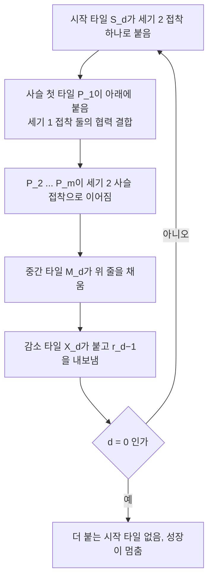

# 풀이 후보 (Possible Solutions): 검증 전 초안

> 아래는 **연구 방향과 유도 스케치**다. 논문 본문이 아니다.
> 사실의 출처는 `00_research_notes.md` 하나다. 숫자와 상태를 거기서 그대로 옮겼다.
> 상태 표시는 다음과 같다.
> ✅ 증명됨 (PROVEN, 출처 있음) 또는 손으로 유도함 (DERIVED-BY-HAND, 재확인 필요)
> 🟡 스케치만 있음, 부분 확인, 또는 실행이 필요함
> 🔴 미해결 또는 연구 질문
> **정확한 모서리 시드 공식은 자료에서 찾지 못했다.** 이 문서는 공식을 쓰지 않는다.

---

## 0. 한눈에: 왜 이 문서가 있나

| 칸 | 내용 |
| --- | --- |
| 풀려던 문제 | 시드(seed)가 모서리가 아닌 2×n 직사각형의 복잡도가 열려 있다 |
| 결과·목적 | 알려진 결과와 열린 칸을 한 지도에 놓고, 24시간 안에 쓸 방향을 순위로 고른다 |
| 임무(mission) | 증명된 것과 미확인 것을 섞지 않고 케이스 지도를 만든다 |
| 비전(vision) | 2쪽 논문에 "알려진 것, 새 정리, 열린 질문"을 표 하나로 담는다 |

케이스 지도는 다음과 같다.

```
2×n 직사각형 (입력: 칸 목록이라고 가정)
|
+-- 온도(temperature, τ) = 1
|     +-- 결합 불일치 없음 가정: 정확히 n + 1          🟡 (조건부 증명, 부분 확인)
|     +-- 가정 없음: Ω(√n) ≤ t ≤ n + 1                 🔴 (정확한 값: 열림)
|
+-- 온도(temperature, τ) = 2
      +-- 모서리 시드: √n/2 ≤ t ≤ 4⌈√n⌉ + 2           ✅ (출제자는 식이 있다고 함, 우리는 못 찾음)
      +-- 안쪽 시드:   √n/2 ≤ t ≤ ?                    🔴 (열림: 해커톤 문제)
```

열린 칸은 여럿이다. "열린 곳은 하나"라고 쓰지 않는다.
- 온도 2, 안쪽 시드: 열림. 해커톤 문제다.
- 온도 1, 가정 없는 정확한 값: 열림.
- 온도 2, 모서리 시드: 식이 있다고 하나 우리는 찾지 못했다.

표기는 다음과 같다.

```
n        직사각형의 열 수. 열 1..n, 행 0(아래)과 1(위)
t        타일 종류(tile type) 수
τ        온도(temperature)
m, D     카운터 구성의 한 블록 열 수와 블록 수
```

---

## 알려진 결과 (모든 케이스의 뼈대) ✅

왜 먼저 보나. 아래 값들이 모든 방향의 경계를 정한다.

| 결과 | 설정 | 상태 | 출처 |
| --- | --- | --- | --- |
| 일반 모양의 최소 타일 집합: [NP-완전(NP-complete)](#term-np-complete) | [결정적 조립(directed self-assembly)](#term-directed), 유한 모양 | ✅ 증명됨 | [S-MTS-1] 초록 |
| 정사각형 N×N: 다항 시간 | 결정적 조립, τ = 2 | ✅ 증명됨 | [S-MTS-1], [S-MTS-4] 2쪽 |
| [엄격 조립(strict self-assembly)](#term-strict)의 최소 타일 집합: [Σ2^P-완전(Σ2^P-complete)](#term-sigma2) | 단일 [시드(seed)](#term-seed) 타일, τ = 2 | ✅ 증명됨 | [S-MTS-3] |
| 결정적 조립 검증: 다항 시간 | 표준 모델 | ✅ 증명됨 | [S-MTS-1], [S-MTS-2] |
| k×N 직사각형, k ≥ 2, 정사각형 아님: 정확한 복잡도 | 모든 설정 | 🔴 찾은 결과 없음 | 검색 기록 |

2×n의 하한과 상한은 다음과 같다. 계산은 산술만 했고 실행은 없다.

| 항목 | 값 | 상태 | 출처 |
| --- | --- | --- | --- |
| 하한 (모든 τ, 모든 시드 위치) | t ≥ √n / 2 | ✅ 증명됨 | [S-MTS-2] 정리 3.1 증명, k = 2 |
| 상한 (τ = 2, 모서리 시드) | t ≤ 4⌈√n⌉ + 2 | ✅ 증명됨 | [S-MTS-2] 정리 3.2, k = 2 |
| 예 n = 100 | 5 ≤ t ≤ 42 | 산술 | 위 두 식 |
| 예 n = 10,000 | 50 ≤ t ≤ 402 | 산술 | 위 두 식 |
| 상한 n + 1 ([빗 구성(comb construction)](#term-comb), 모든 τ, 모든 시드 칸) | n + 1 | ✅ 손 유도 (F3) | [S-MTS-5]의 N + k − 1과 맞음 |
| 2×1은 정확히 2 | 2 | ✅ 손 유도 (F1) | 자료 4.1 |
| τ = 1, 결합 불일치 없음 | 정확히 n + 1 | 🟡 조건부 증명(PROVEN-conditional), 부분 확인 | [S-MTS-6] |
| τ = 1, 가정 없음 | Ω(√n) ≤ t ≤ n + 1 | 🔴 정확한 값: 열림 | [S-MTS-5] |

빗 구성은 모서리 시드와 아래 줄 아무 칸의 시드에서 그대로 된다.
위 줄 시드는 위아래로 뒤집은 빗을 쓴다. 그래서 n + 1은 모든 시드 칸에서 성립한다.
빗은 결합 불일치가 없다. 그래서 τ = 1의 제한된 부류 안에 든다.

세 가지를 섞지 않는다.
- τ = 2에서 답은 Θ(√n)이다 (모서리 시드). 상수 차이는 약 8이다 (추정).
- 하한 √n / 2는 시드 위치와 무관하다.
- 상한 4⌈√n⌉ + 2는 모서리 시드에서만 증명되었다.

### 손으로 만든 카운터 (손 유도, 시뮬레이션 전) 🟡

왜 있나. [S-MTS-2]의 4⌈√n⌉ + 2보다 상수가 작을 수 있다.
**이 구성은 손으로 유도했다. 시뮬레이션은 하지 않았다.**
(m, D) = (3, 2)와 (12, 4)에서 손으로 추적했다.

```
n = 1 + m·D 열, 타일 종류 m + 3D + 2개 (시드는 오른쪽 아래 모서리)
서쪽으로 m열 블록씩 자란다
아래 줄: 블록 안 위치를 센다
위 줄:   숫자 d가 D−1에서 0까지 내려간다
```

| 항목 | 값 |
| --- | --- |
| 타일 묶음 | 아래 사슬 m종, 시작 D종, 중간 D종, 감소 D종, 시드와 맨 위 열 2종 |
| m ≈ 3D로 고르면 | 약 2√(3n) ≈ 3.46√n 종 (이론 비교: [S-MTS-2]는 4√n + 2) |
| 예 D = 4, m = 12 | n = 49, 26종 (빗 구성은 50종) |
| 예 D = 58, m = 173 | n = 10,035, 349종 |
| 한계 | m ≥ 2이고 n = 1 + m·D만 정확히 다룬다. 다른 길이는 첫 블록을 일부만 쓰는 방식이 필요하다. 풀지 않았다 |
| 상태 | 🟡 손으로 추적함. 시뮬레이션(R2)은 선택이며, 결정적 조립인지와 종단 모양을 독립 확인한다 |

접착 라벨의 규칙은 다음과 같다.
- 아래 사슬 P_{j+1}의 동쪽 접착 p_j는 세기 2다.
- 이유: 세기 1이면 P_{j+1}이 위쪽 M을 기다리고, M은 아래쪽 P를 기다려 교착한다.
- 자릿수 접착은 자릿수 d마다 다른 라벨 δ_d를 쓴다.
- 이유: 라벨 하나를 공유하면 X₁과 X₀가 같은 칸에 함께 맞아 경쟁한다. 결정적 조립이 깨진다.
- m = 2이면 M_d가 쓰이지 않아 타일 종류는 m + 2D + 2개다.

한 블록의 순서는 다음과 같다.



추측 (CONJECTURE): 온도 2 모서리 시드의 최적값은 c·√n + O(1)이다.
c는 1/2과 2√3 ≈ 3.46 사이다.
출제자의 "식"은 이런 형태일 가능성이 있다. 정확한 형태는 어떤 출처에서도 찾지 못했다.

---

## 케이스별 방향 (안쪽 시드)

### 안쪽 시드에서 달라지는 점 🟡

시드가 열 s에 있다고 하자 (1 < s < n).
이 절은 모두 추정이다.

```
서쪽 팔 길이 s − 1  <--  [시드]  -->  동쪽 팔 길이 n − s
```

- 두 팔이 자란다.
- 하한 √n / 2는 그대로 성립한다 ([S-MTS-2] 정리 3.1은 시드 위치와 무관하다).
- 두 팔에 카운터를 따로 쓰면 비용이 약 c√a + c√b이다 (a + b = n − 1). 모서리의 c√n보다 크다.
- 안쪽 시드가 이기려면 두 팔이 타일 종류를 공유해야 한다.
- 타일은 회전하지 않는다. 서쪽으로 자라는 타일과 동쪽으로 자라는 타일은 접착이 두 방향에 모두 맞아야 한다. 이것이 핵심이다.

### 방향 순위

24시간 안에 2쪽 논문에 넣을 수 있는 순서다. 순위는 자료의 것을 그대로 옮겼다.

| 순위 | 방향 | 지원하는 주장 | 위험 | 상태 |
| --- | --- | --- | --- | --- |
| 1 | **희소성으로 NP-완전 배제.** n을 일진수로 주거나 정렬된 칸 목록(Θ(n log n) 비트)으로 준다. 그러면 입력 길이마다 k 값이 O(n)개, 시드 칸 s가 O(n)개다. 그래서 언어가 [희소 집합(sparse set)](#term-sparse)이다. [마하니 정리(Mahaney's theorem)](#term-mahaney)는 희소 NP-어려움 집합이 다대일 다항 시간 환원 아래 있으면 P = NP라고 한다 [S-MTS-7]. 정렬 안 된 칸 목록은 같은 모양의 인코딩이 (2n)!개라 그대로는 희소하지 않다. 이때는 "아무 인코딩 → 정규형 ⟨1^n, s, k⟩"인 다항 시간 환원을 더한다. 직사각형이 아닌 입력은 고정된 아니오 인스턴스로 보낸다 | "2×n 최소 타일 집합은 P = NP가 아닌 한 NP-완전이 아니다" (어떤 시드 규칙에서도) | 낮음. 인코딩을 명시해야 한다. n을 이진수로 주면 희소하지 않아 논증이 무너진다. NP 소속에는 τ를 고정하거나 세기를 제한해야 한다 | 🟡 짧고 엄밀한 정리 후보. 출처는 부분 확인 |
| 2 | **준지수 시간 알고리즘.** 고정 τ = 2에서 타일 종류 4⌈√n⌉ + 2개 이하인 모든 시스템을 나열한다. 후보는 2^{O(√n log n)}개이고, 각 후보를 다항 시간 검증 [S-MTS-1]으로 확인한다 | "2^{O(√n log n)} 시간에 풀린다". 고정 τ = 2이고 입력이 일진수 n 또는 칸 목록일 때만이다. 순위 1과 짝이 맞다 | 낮음. 이진수 입력에서는 입력 길이가 log n이라 준지수가 아니다. τ = 1은 상한이 n + 1뿐이라 같은 나열이 2^{O(n log n)}이다 | 🟡 |
| 3 | **모서리로 일반성을 잃지 않는다는 보조정리 (교환 논증, [exchange argument](#term-exchange)).** 안쪽 시드의 최적 시스템이 타일 종류 수를 늘리지 않고 모서리 시드 시스템으로 바뀜을 보인다. 그러면 일반 경우가 모서리 공식과 같고 다항 시간이다 | 열린 경우를 닫는다 | 높음. 두 팔이 타일을 공유하면 거짓일 수 있다 | 🔴 |
| 4 | **시드 위치 분해.** 최적값(optimum, OPT)을 모든 s에 대한 f(s − 1, n − s)의 최솟값으로 쓴다. f는 타일 공유를 허용한 두 팔의 비용이다. f의 닫힌 식이 있으면 O(n) 시간 알고리즘이 된다 | f를 조건으로 한 다항 시간 알고리즘 | 중간에서 높음 | 🔴 |
| 5 | **상수 배 근사.** 시드를 풀이의 일부로 고르는 경우, [S-MTS-2]의 모서리 구성(4⌈√n⌉ + 2, 증명됨)을 하한 √n / 2와 견준다. 비율은 약 8로 간다 (작은 n에서 약 11 이하). "7배"(3.46 / 0.5)는 손 카운터를 쓰는 점근 값이다. n = 1 + m·D에만 쓸 수 있다. 시드 칸이 입력으로 고정된 경우는 서쪽으로 자라는 카운터 하나와 동쪽으로 자라는 거울 카운터 하나를 시드 열에서 잇고 라벨을 서로 다르게 쓴다. 타일 종류는 4√2·√n + O(1) 이하이고 비율은 약 8√2 ≈ 11.3이다 | "약 8-근사 (시드 자유, [S-MTS-2])". "7배 (n = 1 + m·D, 손 카운터)". "약 8√2배 (시드 칸 고정)" | 낮음. 고정 시드는 [S-MTS-2]의 카운터가 팔 길이 1..m²를 모두 다룬다는 논문 주장에 기댄다 (재확인 안 함) | 🟡 |
| 6 | **작은 n의 정확한 표를 클러스터로 얻는다.** n ≤ 8에서 모서리 최적과 안쪽 최적을 비교한다 | 순위 3의 찬반 증거 | 클러스터 실행과 소유자 동의 필요 | 🟡 |
| 7 | **어려움 증명.** 2×n의 NP-어려움은 칸 목록 인코딩에서 순위 1이 막는다 | 권장하지 않음 | 매우 높음 | 🔴 |

현실적인 24시간 논문 (추정): 순위 1과 2를 정리로 쓴다.
순위 5의 8배 형태는 [S-MTS-2]만 있으면 정리로 쓴다.
순위 5의 7배 형태는 손 카운터가 필요하다.
순위 3은 순위 6의 데이터를 붙인 추측으로 쓴다.

---

## 검증 계획 (실행은 클러스터에서)

왜 이 표인가. 손으로 얻은 값과 구성이 맞는지, 작은 n의 정확한 값이 무엇인지 확인한다.

| 실험 | 입력 | 출력 | 기대 | 실행 위치 |
| --- | --- | --- | --- | --- |
| R1 | 2×n, n = 2..8, τ = 1과 τ = 2, 시드 위치마다 | n, 시드 위치, 최소 타일 종류 수 t, 증인 타일 집합 하나 | 작은 n 표 (n = 1은 2, 나머지는 실행 필요). 순위 3의 찬반 증거 | 실행은 클러스터에서 |
| R2 (선택) | 손 구성의 몇 개 (m, D) | 결정적 조립 여부, 종단 모양 | 손 추적을 독립 확인한다. 종단 모양이 2×(1 + m·D)이고 결정적 조립이면 순위 5의 7배 형태가 확실해진다 | 실행은 클러스터에서 |

R1의 방법은 다음과 같다.
1. 타일 종류 수 t ≤ n + 1인 τ 시스템을 나열한다.
2. 각 후보를 [S-MTS-1]의 다항 시간 유일성 검사로 확인한다.
3. 시드 위치(모서리와 안쪽 칸)마다 최소 t를 기록한다.

작은 n의 표는 다음과 같다. 실행 전이다.

| n | 증명·유도된 하한 | 찾은 최선 상한 (구성) | 정확한 값 |
| --- | --- | --- | --- |
| 1 | 2 (F1) | 2 | **2** (손 유도) |
| 2 | 2 | 3 (빗) | 실행 필요 |
| 3 | 2 | 4 | 실행 필요 |
| 4 | 2 | 5 | 실행 필요 |
| 5 | 2 | 6 | 실행 필요 |
| 6 | 2 | 7 | 실행 필요 |

n ≤ 6에서는 빗 n + 1이 찾은 최선 구성이다. 카운터는 큰 n에서만 이득이다 (추정).

이 계산은 전수 탐색이다. 이 머신 규칙상 로컬에서 돌리지 않는다.
메인 세션만 제출한다. 에이전트는 작업 스크립트를 쓰고 넘긴다.

---

## 용어 부록 (terms appendix)

<a id="term-np-complete"></a>
- **NP-완전(NP-complete)**: 답을 빨리 검증할 수 있고, 같은 부류의 모든 문제를 이 문제로 바꿀 수 있는 가장 어려운 문제군.

<a id="term-sigma2"></a>
- **Σ2^P-완전(Σ2^P-complete)**: NP보다 한 층 위의 계산 복잡도 부류에서 가장 어려운 문제군.

<a id="term-comb"></a>
- **빗 구성(comb construction)**: 아래 줄에 서로 다른 타일 n개, 위 줄에 같은 타일 하나를 쓰는 n + 1종 구성.

<a id="term-sparse"></a>
- **희소 집합(sparse set)**: 길이 L의 원소 수가 L의 다항식 이하인 집합.

<a id="term-mahaney"></a>
- **마하니 정리(Mahaney's theorem)**: 희소한 NP-어려움 집합이 다대일 다항 시간 환원 아래 있으면 P = NP라는 정리.

<a id="term-directed"></a>
- **결정적 조립(directed self-assembly)**: 종단 조립체가 정확히 하나이고 그 모양이 목표 모양인 경우.

<a id="term-strict"></a>
- **엄격 조립(strict self-assembly)**: 모든 종단 조립체의 모양이 목표 모양인 경우. 실행마다 타일 종류가 달라도 된다.

<a id="term-seed"></a>
- **시드(seed)**: 정해진 자리에 놓인 첫 타일. 모든 성장이 여기서 시작한다.

<a id="term-exchange"></a>
- **교환 논증(exchange argument)**: 최적 해의 한 부분을 바꿔도 값이 나빠지지 않음을 보여 다른 형태의 해로 옮기는 증명 방법.
