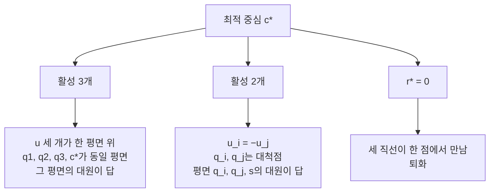

# Wylie: 3D에서 세 직선에 닿는 최소 원 학습 가이드

> 시각화는 같은 폴더의 `study_tips.html`을 브라우저로 열어줘.
> 3D 케이스 탐색기, 결정 흐름도, 케이스 표, 타임라인이 들어 있다.
> 해커톤 조건 (READMME.md): 11/7 09:00 → 11/8 09:00.
> 제출물은 **2쪽 Overleaf 논문 하나**이고, 그것만 심사한다.

---

## 0. 한눈에: 왜 이 가이드가 필요한가

세 직선의 위치 관계마다 답이 달라 보인다. 케이스가 많아 하나씩 풀면 2쪽에 담을 수 없다.
이 가이드는 케이스를 하나의 질문으로 묶는 길을 보여준다.

| 칸 | 내용 |
| --- | --- |
| 풀려던 문제 | 세 직선과 만나는 원이 케이스마다 따로 풀린다 |
| 결과·목적 | 케이스 분석을 "활성 제약이 2개인가 3개인가" 판정으로 줄인다 (가설) |
| 임무(mission) | 닫힌 형태(closed form)로 중심 c, 반지름 r, 평면 법선 n을 구한다 |
| 비전(vision) | 가능한 한 많은 케이스를 푸는 2쪽 논문을 낸다 |

전체 흐름은 다음과 같다.

```
세 직선 L1, L2, L3
      |
      v
최소 접촉 구 (이차 원뿔 계획법으로 검증)
      |
      v
활성 제약이 몇 개인가
   |            |
  2개          3개
   |            |
   v            v
쌍 하한 r = ρ_ij   세 직선에서 등거리 + 동일 평면
   |            |
   +-----+------+
         v
   대원 = 답 (c, r, n)
```

각 상자의 용어는 문서 끝 [용어 부록](#용어-부록-terms-appendix)에 있다.

---

## 1. 문제를 한 줄로

3D 무한 직선 L1, L2, L3가 주어진다.
세 직선 모두와 만나는 가장 작은 원을 닫힌 형태([닫힌 형태(closed form)](#term-closed-form))로 구한다.
원은 중심 c, 반지름 r, 평면 법선 n으로 정한다.
가능한 한 많은 케이스를 푸는 것이 목표다.

PDF가 요구하는 출력은 세 가지다.

```
center point
radius
plane
```

---

## 2. 먼저 익힐 기초 (순서대로, 각 30분 이내)

왜 이 순서인가. 아래 통찰(3장)을 증명하는 도구를 앞에서부터 쌓는다.


| # | 주제 | 왜 필요한가 | 셀프 체크 |
| --- | --- | --- | --- |
| 1 | 직선 표현. 벡터형 `a + t·d`, 두 점형, [플뤼커 좌표(Plücker coordinates)](#term-plucker) | 입력 형식이 정해지지 않았다 (PDF: "point-slope vs vector") | 두 점형을 벡터형으로 바꿀 수 있는가 |
| 2 | 점-직선 거리와 [수선의 발(foot of perpendicular)](#term-foot-of-perpendicular) | 모든 케이스의 기본 연산이다 | 공식을 외우지 않고 유도할 수 있는가 |
| 3 | 두 직선의 관계 판정. 평행, 교차, [꼬인 위치(skew lines)](#term-skew-lines), 일치 | 케이스 분류 그 자체다 | 아래 두 식으로 판정한다 |
| 4 | 두 직선 사이 최단 거리와 [공통 수선(common perpendicular)](#term-common-perpendicular) | 꼬인 두 직선의 "중점"이 핵심 후보다 | 최근접점 두 개의 공식 |
| 5 | 삼각형의 [내접원(incircle)](#term-incircle) | PDF가 직접 언급한 기준 케이스다 | 아래 두 식을 확인한다 |
| 6 | [외접원(circumcircle)](#term-circumcircle)과 [최소 포함원(minimum enclosing circle, MEC)](#term-mec) | 세 평행선 케이스에서 쓴다 | 둔각이면 최소 포함원은 최장변의 절반이다 |
| 7 | [볼록 함수(convex function)](#term-convex-function), [미니맥스(minimax)](#term-minimax), [카루시-쿤-터커 조건(Karush-Kuhn-Tucker conditions, KKT)](#term-kkt), [서브그래디언트(subgradient)](#term-subgradient) | 아래 **통합 정리**를 증명하는 도구다 | `max`의 [서브그래디언트(subgradient)](#term-subgradient)는 [활성 제약(active constraint)](#term-active-constraint) 기울기의 볼록 결합이다 |
| 8 | [아폴로니우스 점-직선-직선 문제(Apollonius point-line-line problem, PLL)](#term-pll) | 수직선 특수 케이스가 이 문제로 환원된다 | 2차방정식으로 풀린다 |
| 9 | [이차 원뿔 계획법(second-order cone programming, SOCP)](#term-socp) | 수치 검증기를 만드는 데 쓴다 | 아래 식으로 쓴다 |

3번 행의 판정식은 다음과 같다.

```
d1 × d2
(a2 − a1) · (d1 × d2)
```

4번 행의 거리식은 다음과 같다.

```
점-직선 거리 = ‖(c − a) − ((c − a) · d) d‖
```

5번 행의 식은 다음과 같다.

```
r = 2 · Area / perimeter
내심 = (a·A + b·B + c·C) / (a + b + c)
```

9번 행의 문제 식은 다음과 같다.

```
min r
s.t. ‖P_i (c − a_i)‖ ≤ r
```

참고문헌 후보다. 논문에 인용하기 전에 서지 정보를 직접 확인해줘.

- Boyd & Vandenberghe, *Convex Optimization* (2004): [이차 원뿔 계획법(second-order cone programming, SOCP)](#term-socp)과 [카루시-쿤-터커 조건(Karush-Kuhn-Tucker conditions, KKT)](#term-kkt)
- Welzl (1991), smallest enclosing disks: [최소 포함원(minimum enclosing circle, MEC)](#term-mec) 배경
- Apollonius 문제: 표준 기하 교재

---

## 3. 가장 중요한 통찰 (먼저 이해할 것)

### 3.1 "원"을 "구"로 바꾸면 문제가 볼록해진다

왜 바꾸나. 원은 다루기 어렵고, 구는 [볼록 함수(convex function)](#term-convex-function)로 풀린다.

```
원 C(c, r) ⊂ 구 B(c, r)
원이 L과 만남 → 구도 L과 만남
```

원 C(c, r)이 직선 L과 점 p에서 만난다고 하자. 그러면 다음이 성립한다.

```
dist(c, L) ≤ |c − p|
|c − p| = r
```

따라서 반지름의 하한이 나온다.

```
r ≥ r* := min_c max_i dist(c, L_i)
```

r*는 [교차 반지름(intersection radius)](#term-intersection-radius)이다.
곧 세 직선 모두와 만나는 [최소 접촉 구(minimum touching ball)](#term-min-touching-ball)의 반지름이다.
`dist(c, L_i)`가 볼록이므로 이 문제는 3변수 볼록 최적화다.
수치로는 [이차 원뿔 계획법(second-order cone programming, SOCP)](#term-socp)이 된다.

### 3.2 하한이 항상 달성된다 ([대원(great circle)](#term-great-circle) 정리)

왜 중요한가. 하한이 달성되면 구의 답이 곧 원의 답이다.

최적 중심 c*에서 [활성 제약(active constraint)](#term-active-constraint)을 정한다.
거리가 정확히 r*인 직선이 활성이다.
활성 직선의 [수선의 발(foot of perpendicular)](#term-foot-of-perpendicular)을 q_i라 하자.
단위벡터를 정의한다.

```
u_i = (c* − q_i) / r*
```

[카루시-쿤-터커 조건(Karush-Kuhn-Tucker conditions, KKT)](#term-kkt)은 다음과 같다.

```
Σ λ_i u_i = 0
λ_i ≥ 0
```

경우는 세 가지다.



- **활성 3개**: 단위벡터 3개의 양의 결합이 0이면 세 벡터는 한 평면 위에 있다. 그래서 q1, q2, q3, c*가 한 평면에 놓인다. 그 평면의 [대원(great circle)](#term-great-circle)이 세 직선 모두에 닿는다.
- **활성 2개**: `u_i = −u_j`이다. 곧 q_i와 q_j는 구의 [대척점(antipodal points)](#term-antipodal)이다. 세 번째 직선은 구 내부를 지난다. 그 직선은 구면과 점 s에서 만난다. 평면 (q_i, q_j, s)는 c*를 포함한다. 이 평면의 [대원(great circle)](#term-great-circle)이 답이다.
- **r* = 0**: 세 직선이 한 점에서 만나는 경우다 ([퇴화(degenerate)](#term-degenerate)).

> **정리 (가설, 논문의 핵심 보조정리 후보)**
> 세 직선과 만나는 최소 원의 반지름은 [최소 접촉 구(minimum touching ball)](#term-min-touching-ball)의 반지름과 같다.
> 그 원은 그 구의 [대원(great circle)](#term-great-circle)이다.
> 원을 곡선이 아니라 원판으로 해석해도 원판 ⊂ 구이므로 답이 같다.

이 정리가 "지루한 케이스 분석"을 한 질문으로 줄인다.
그 질문은 "어떤 제약이 활성인가, 2개인가 3개인가"이다.
Figure 1의 over/under, between/outside 구분은 이 활성 집합의 차이일 가능성이 크다.
케이스마다 검증해줘.

### 3.3 쌍(pair) 하한과 판정 알고리즘

왜 쓰나. 두 직선만 보면 활성 2개 여부를 빠르게 가린다.

두 직선 i, j의 하한을 정의한다.

```
ρ_ij = dist(L_i, L_j) / 2
```

이 하한을 달성하는 중심 집합 C_ij는 관계에 따라 다르다.

| 두 직선의 관계 | 중심 집합 C_ij |
| --- | --- |
| 교차 | 교점 하나 (ρ = 0) |
| 꼬인 위치 | [공통 수선(common perpendicular)](#term-common-perpendicular)의 중점 하나 |
| 평행 | 두 직선 사이의 중앙선 M (직선 전체) |

판정 순서는 다음과 같다.

```
r* ≥ max_{i<j} ρ_ij

1. ρ가 최대인 쌍 (i, j)를 고른다.
2. dist(C_ij, L_k) ≤ ρ_ij 이면
     → 활성 2개, r* = ρ_ij
3. 아니면
     → 활성 3개
     → c는 세 직선에서 등거리
     → q1, q2, q3, c는 동일 평면
```

---

## 4. 학습 순서 체크리스트

- [ ] PDF Figure 1의 18개 그림을 손으로 다시 그린다. 각 그림에 "평행 쌍 수 / 교차 쌍 수 / 꼬인 쌍 수"를 적는다.
- [ ] 3.1의 하한 증명을 직접 5줄로 써 본다.
- [ ] 3.2의 [카루시-쿤-터커 조건(Karush-Kuhn-Tucker conditions, KKT)](#term-kkt) 논증을 직접 써 본다. "양의 결합 = 0 ⇒ 동일 평면"이 왜 성립하는지 확인한다.
- [ ] `study_tips.html`의 모든 프리셋을 누른다. 활성 집합이 2개인지 3개인지 표로 정리한다.
- [ ] 쉬운 케이스부터 닫힌 해를 유도한다. 순서는 아래 그림과 같다.
- [ ] 각 닫힌 해를 수치 [이차 원뿔 계획법(second-order cone programming, SOCP)](#term-socp)과 비교하는 검증 계획을 세운다. 실행은 클러스터에서 한다 (5장 참고).

```
삼각형 → 3평행 → 2평행 → 수직 특수 → 1교차 → 전부 꼬인
(쉬움)                                       (어려움)
```

---

## 5. 함정 (Pitfalls)

1. **"touch"의 해석.** 교차(intersect)인지 접함([접함(tangent)](#term-tangent))인지에 따라 답이 다르다. PDF의 삼각형 = [내접원(incircle)](#term-incircle) 진술은 두 해석 모두와 맞는다. 하지만 활성 2개 케이스에서 우리 원은 세 번째 직선을 *가로지른다*. 그래서 접함 해석과는 다르다. 출제자(Wylie)에게 해석을 확인해줘. 논문에도 명시해줘.
2. **PDF에 없는 [퇴화(degenerate)](#term-degenerate) 케이스.** 세 직선이 한 점에서 만나는 경우(r = 0)가 있다. 두 직선이 일치하는 경우도 있다. "3 meet" 그림은 삼각형만 보여준다. [공점(concurrent lines)](#term-concurrent-lines) 케이스를 언급하면 완전성 점수에 도움이 된다.
3. **해의 비유일성.** 평행선이 있으면 중심이 선분 위 어디든, 또는 직선 위 어디든 될 수 있다. 활성 2개 케이스에서는 평면도 여러 개 가능하다. "the" circle이 아니라 "a" minimal circle의 족(family)으로 서술해줘.
4. **3평행 둔각 케이스.** 원의 평면이 직선 방향에 수직이 아니다. 평면이 *기울어진다*. 직관과 반대라서 그림으로 보여주기 좋은 결과다.
5. **수치 허용오차.** 평행과 교차 판정에 ε가 필요하다. 논문에 [정확 산술(exact arithmetic)](#term-exact-arithmetic) 가정을 명시해줘.
6. **일반 꼬인 3직선 (활성 3개).** 근호로 된 닫힌 해가 없을 수 있다. 다항식 차수가 높기 때문이다. 무리하게 닫힌 해를 주장하지 마. "단변수 다항식으로 환원하고 차수를 제시"하는 편이 정직하고 강하다.

---

## 6. 계산 작업에 관한 주의 (이 머신 규칙)

왜 막는가. 이 머신에서 계산을 돌리면 CPU를 오래 점유한다. 규칙은 `~/.claude/CLAUDE.md`에 있다.

```
로컬 금지                      로컬 허용
---------------------------    ---------------------------
수치 검증 (이차 원뿔 계획법,   저장된 결과로 그림 그리기
  랜덤 인스턴스 비교)
기호 계산 (그뢰브너 기저 등)
```

- 수치 검증과 기호 계산은 로컬에서 바로 실행하지 않는다.
- 수치 검증은 [이차 원뿔 계획법(second-order cone programming, SOCP)](#term-socp)과 랜덤 인스턴스 비교다.
- 기호 계산은 [그뢰브너 기저(Gröbner basis)](#term-groebner)와 [종결식(resultant)](#term-resultant)이다.
- 프로젝트 루트 `CLAUDE.md`에 계산 환경이 아직 없다.
- 먼저 어떤 클러스터나 Colab을 쓸지 정해줘.
- 저장된 결과로 그림을 그리는 작업은 로컬에서 해도 된다.

---

## 용어 부록 (terms appendix)

<a id="term-socp"></a>
- **이차 원뿔 계획법(second-order cone programming, SOCP)**: 노름 부등식 `‖Ax + b‖ ≤ cᵀx + d` 아래에서 선형 함수를 최소화하는 볼록 최적화.

<a id="term-kkt"></a>
- **카루시-쿤-터커 조건(Karush-Kuhn-Tucker conditions, KKT)**: 제약 최적화의 최적점이 만족하는 필요조건. 기울기의 가중합이 0이다.

<a id="term-mec"></a>
- **최소 포함원(minimum enclosing circle, MEC)**: 주어진 점들을 모두 안에 담는 가장 작은 원.

<a id="term-pll"></a>
- **아폴로니우스 점-직선-직선 문제(Apollonius point-line-line problem, PLL)**: 점 하나와 직선 둘에 접하는 원을 구하는 문제. 2차방정식으로 풀린다.

<a id="term-intersection-radius"></a>
- **교차 반지름(intersection radius)**: 세 직선과 모두 만나는 구의 최소 반지름 r*.

<a id="term-min-touching-ball"></a>
- **최소 접촉 구(minimum touching ball)**: 세 직선 모두와 만나는 가장 작은 구.

<a id="term-great-circle"></a>
- **대원(great circle)**: 구의 중심을 지나는 평면이 구면과 만나서 생기는 원.

<a id="term-skew-lines"></a>
- **꼬인 위치(skew lines)**: 평행하지도 만나지도 않는 두 직선의 관계.

<a id="term-common-perpendicular"></a>
- **공통 수선(common perpendicular)**: 꼬인 두 직선에 모두 수직인 선분. 길이가 두 직선 사이 최단 거리다.

<a id="term-foot-of-perpendicular"></a>
- **수선의 발(foot of perpendicular)**: 점에서 직선에 내린 수선이 직선과 만나는 점.

<a id="term-active-constraint"></a>
- **활성 제약(active constraint)**: 최적점에서 등호로 성립하는 제약. 여기서는 거리가 정확히 r*인 직선.

<a id="term-convex-function"></a>
- **볼록 함수(convex function)**: 두 점을 잇는 현이 그래프 위쪽에 있는 함수. 지역 최소가 곧 전역 최소다.

<a id="term-minimax"></a>
- **미니맥스(minimax)**: 여러 값의 최댓값을 가장 작게 만드는 최적화.

<a id="term-subgradient"></a>
- **서브그래디언트(subgradient)**: 미분 불가능한 볼록 함수에 쓰는 기울기의 일반화.

<a id="term-incircle"></a>
- **내접원(incircle)**: 삼각형의 세 변에 모두 접하는 원.

<a id="term-circumcircle"></a>
- **외접원(circumcircle)**: 삼각형의 세 꼭짓점을 모두 지나는 원.

<a id="term-concurrent-lines"></a>
- **공점(concurrent lines)**: 한 점에서 만나는 세 개 이상의 직선.

<a id="term-degenerate"></a>
- **퇴화(degenerate)**: 일반 경우의 구조가 무너진 특수 경우. 여기서는 r* = 0인 경우.

<a id="term-plucker"></a>
- **플뤼커 좌표(Plücker coordinates)**: 방향 벡터와 모멘트 벡터 한 쌍으로 3D 직선을 나타내는 좌표.

<a id="term-groebner"></a>
- **그뢰브너 기저(Gröbner basis)**: 다항식 연립방정식을 변수 소거가 쉬운 형태로 바꾼 생성 집합.

<a id="term-resultant"></a>
- **종결식(resultant)**: 두 다항식이 공통근을 가질 조건을 계수로 나타낸 식.

<a id="term-closed-form"></a>
- **닫힌 형태(closed form)**: 유한 개의 기본 연산으로 쓴 해의 식.

<a id="term-antipodal"></a>
- **대척점(antipodal points)**: 구의 중심에 대해 서로 반대쪽에 있는 두 점.

<a id="term-tangent"></a>
- **접함(tangent)**: 곡선과 직선이 한 점에서 스치듯 만나는 관계.

<a id="term-exact-arithmetic"></a>
- **정확 산술(exact arithmetic)**: 반올림 오차 없이 계산한다는 가정.
