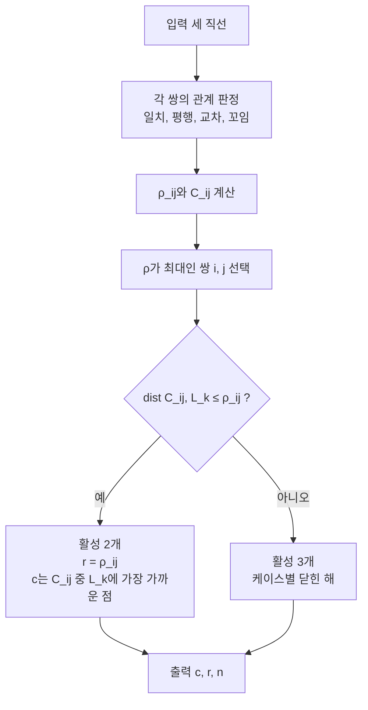

# 풀이 후보 (Possible Solutions): 검증 전 초안

> 아래는 **연구 방향과 유도 스케치**다. 논문 본문이 아니다.
> 상태 표시는 다음과 같다.
> ✅ 유도 완료 (손으로 재확인 필요)
> 🟡 스케치만 있음
> 🔴 미해결 또는 연구 질문

---

## 0. 한눈에: 왜 이 문서가 있나

| 칸 | 내용 |
| --- | --- |
| 풀려던 문제 | 세 직선과 만나는 최소 원을 케이스마다 따로 풀어야 한다 |
| 결과·목적 | 핵심 정리 하나로 케이스 분석을 활성 집합 판정으로 줄인다 |
| 임무(mission) | 케이스마다 닫힌 형태(closed form)의 (c, r, n)을 낸다 |
| 비전(vision) | 2쪽 논문에 케이스 표 하나로 담는다 |

케이스 지도는 다음과 같다.

```
세 직선 L1, L2, L3
|
+-- A. 모두 한 평면 위     (A1 삼각형, A2 공점, A3 2평행+횡단선, A4 3평행 공면)
+-- B. 정확히 한 쌍 평행   (L1 ∥ L2)
+-- C. 세 직선 모두 평행   (C1 예각, C2 둔각, C3 공면)
+-- D. 수직선 특수 케이스  (D1 1교차, D2 1꼬임, D3 띠 안, D4 띠 밖)
+-- E. 평행 없음, 일부 교차 (E1 2교차 1꼬임, E2 1교차 2꼬임)
+-- F. 모두 꼬인 위치      (연구 질문)
```

표기는 다음과 같다.

```
직선        L_i = { a_i + t d_i }
단위 방향   |d_i| = 1
사영 행렬   P_i = I − d_i d_iᵀ
거리        dist_i(c) = |P_i (c − a_i)|
수선의 발   q_i(c) = a_i + ((c − a_i) · d_i) d_i
```

[수선의 발(foot of perpendicular)](#term-foot-of-perpendicular)은 위 마지막 식이다.

---

## 핵심 정리 (모든 케이스의 뼈대) ✅

왜 먼저 보나. 아래 두 보조정리가 모든 케이스를 한 판정으로 묶는다.

**Lemma 1 (하한).**
세 직선 모두와 만나는 원의 반지름은 다음을 만족한다.

```
r ≥ r*
r* = min_c max_i dist_i(c)
```

증명은 다음과 같다.
원 위의 점 p_i ∈ L_i에 대해 아래가 성립한다.

```
dist_i(c) ≤ |c − p_i|
|c − p_i| = r
```

여기서 r*는 [교차 반지름(intersection radius)](#term-intersection-radius)이다.

**Lemma 2 (달성).**
r*을 주는 구 B(c*, r*) 안에 대원이 있다.
그 [대원(great circle)](#term-great-circle) 중 세 직선 모두와 만나는 것이 존재한다.

증명 스케치는 다음과 같다.
[카루시-쿤-터커 조건(Karush-Kuhn-Tucker conditions, KKT)](#term-kkt)은 아래와 같다.

```
Σ λ_i u_i = 0
u_i = (c* − q_i) / r*
```

- [활성 제약(active constraint)](#term-active-constraint)이 3개인 경우: u_i가 동일 평면이다. 그래서 평면 (q1, q2, q3)가 c*를 지난다.
- 활성 제약이 2개인 경우: u_i = −u_j이다. 세 번째 직선이 구면과 만나는 점 s를 잡는다. 평면 (q_i, q_j, s)를 쓴다.

**Theorem.**
최소 원은 [최소 접촉 구(minimum touching ball)](#term-min-touching-ball)의 [대원(great circle)](#term-great-circle)이다.
반지름은 r*이고 중심은 c*이다.

- 의미 1: 문제가 3변수 [이차 원뿔 계획법(second-order cone programming, SOCP)](#term-socp)이 된다. 그래서 전역 최적을 수치로 검증할 수 있다.
- 의미 2: 케이스 분석이 "활성 집합이 {i,j}인가 {1,2,3}인가"로 정리된다.

### 통합 알고리즘 (closed-form dispatcher) 🟡

왜 필요한가. 입력마다 어느 케이스 식을 쓸지 자동으로 고른다.



각 단계는 다음과 같이 쓴다.

```
1. 각 쌍 (i, j)의 관계: 일치 / 평행 / 교차 / 꼬인
2. ρ_ij = dist(L_i, L_j) / 2
   C_ij  = { 교점 | 공통 수선의 중점 | 중앙선 M_ij }
3. ρ_max 쌍 (i, j)에 대해 dist(C_ij, L_k) ≤ ρ_ij 인가
     예     → 활성 2개
              r = ρ_ij
              c ∈ C_ij (L_k에 가장 가까운 점)
              평면 = span(q_i − c, s − c)
              s ∈ L_k ∩ 구면
     아니오 → 활성 3개 → 아래 케이스별 닫힌 해
4. 출력 (c, r, n)
```

판정은 O(1) 산술이다. 각 단계가 닫힌 형태([닫힌 형태(closed form)](#term-closed-form))다.
남는 문제는 4번의 "활성 3개" 서브케이스뿐이다.
2번의 [공통 수선(common perpendicular)](#term-common-perpendicular) 중점은 꼬인 쌍에 쓴다.

---

## 케이스별 해

### A. 세 직선이 모두 한 평면 위에 있는 경우

| 케이스 | 해 | 상태 |
| --- | --- | --- |
| A1. 삼각형 (3 meet, 서로 다른 세 교점) | [내접원(incircle)](#term-incircle)이 답이다. 활성 3개. 평면 법선이 n이다.<br>`c = (aA + bB + cC) / (a + b + c)`<br>`r = 2·Area / (a + b + c)` | ✅ |
| A2. [공점(concurrent lines)](#term-concurrent-lines) (세 직선이 한 점 P에서 만남, 공면이 아니어도 됨) | `r = 0`<br>`c = P`<br>[퇴화(degenerate)](#term-degenerate) 케이스다. **PDF 그림에 없는 케이스**다 | ✅ |
| A3. 2평행 + 두 직선 모두와 만나는 [횡단선(transversal)](#term-transversal) | `r = w/2` (w = 평행선 간격). 중심은 중앙선 M 위의 선분 전체다. 횡단선과의 거리가 w/2 이하인 점이다. 해가 하나가 아니다 | ✅ |
| A4. 3평행, 공면 | `r = (바깥 두 직선 간격)/2`. 중심은 중앙선 위 어디든 된다. 직선 방향으로 평행이동이 자유롭다 | ✅ |

### B. 정확히 한 쌍이 평행 (L1 ∥ L2, 간격 w = 2h)

좌표는 다음과 같다.

```
L1 = (−h, t, 0)
L2 = ( h, t, 0)
M  = ( 0, t, 0)      중앙선
L3 = P + s e         |e| = 1
```

**판정.** `dist(M, L3) ≤ h`이면 활성 2개이고 `r = h`이다 ✅

- "2 parallel, 1 meets both" (공면)는 **항상** r = h이다.
- "1 meet 1 cross"도 **항상** r = h이다.
- L3가 L1과 만나면 아래 식이 성립한다.

```
dist(M, L3) = |e_z| / √(e_x² + e_z²) · h
dist(M, L3) ≤ h
```

- "perpendicular between"은 r = h이다.
- "perpendicular outside"는 다른 쌍 (L_far, L3)이 최대 ρ가 된다.

**활성 3개 (dist(M, L3) > h)** 🟡

왜 한 식으로 닫히나. 등거리 조건이 x를 고정하고, 나머지가 2차식이 되기 때문이다.

등거리 조건 d1 = d2에서 아래가 나온다.

```
x = 0
r² = h² + z²
```

`Q(y, z)`를 정의한다.

```
Q(y, z) = d3²(0, y, z) − z²
```

Q는 (y, z)의 2차식이다.
y에 대해 최소화한다. 계수 `1 − e_y² > 0`이다.
결과는 z의 2차식이다.

```
q(z) = A z² + B z + C
A = −e_z² / (1 − e_y²) ≤ 0
```

방정식 `q(z) = h²`의 근 중 |z|가 가장 작은 것을 고른다.
그러면 **2차 공식 하나로 닫힌 해**가 나온다.
남은 일은 (B, C)를 P, e로 명시적으로 전개하는 것이다.

> 주의: 활성 3개가 되려면 최대 ρ 쌍이 (L1, L2)가 아니어야 할 수도 있다. 일반 dispatcher 판정을 먼저 적용해줘.

### C. 세 직선 모두 평행 (방향 d), 단면 삼각형 T

왜 쉬운가. 직선을 따라 점을 움직여도 단면 사영은 T로 고정된다.

```
직선 방향 d
    |   |   |
    A   B   C      ← 각 직선과 단면의 교점
     \  |  /
      삼각형 T = ABC (단면)
```

| 서브케이스 | 해 | 상태 |
| --- | --- | --- |
| C1. T가 예각 | T의 [외접원(circumcircle)](#term-circumcircle)이다. 평면은 d에 수직이다. 활성 3개 | ✅ |
| C2. T가 둔각 또는 직각 | `r = (최장변)/2`. 평면이 **기울어진다**. 둔각 꼭짓점의 직선을 원이 r 거리에서 통과하도록 들어 올린다. 활성 2개 | ✅ |
| C3. 공면 (T 퇴화) | A4와 같다 | ✅ |

증명 아이디어는 다음과 같다.
각 직선 위의 점을 마음대로 올리고 내려도 단면 [사영(projection)](#term-projection)은 T로 고정된다.
따라서 아래 부등식이 성립한다.

```
원 반지름 ≥ 최장 현 / 2
최장 현 / 2 ≥ T의 최장변 / 2
```

그래서 T의 [최소 포함원(minimum enclosing circle, MEC)](#term-mec)이 답이다.
그림 한 장으로 보여주기 좋은 결과다.

### D. 수직선 특수 케이스 (PDF "Special cases"): 대칭으로 2D 환원

설정은 다음과 같다.
L1, L2가 평면 z = 0 위에 있다.
L3은 z축 방향으로 점 S를 지난다.

왜 2D로 줄어드나. 반사 z → −z 대칭과 볼록성 때문에 최적 중심을 z = 0에서 고를 수 있다.
그러면 아래가 성립한다.

```
dist(c, L3) = |c − S|
```

문제가 **평면 위의 [미니맥스(minimax)](#term-minimax): 두 직선 + 한 점**이 된다.

| 케이스 | 해 | 상태 |
| --- | --- | --- |
| D1. 1 meet + 수직선 (교점 P, 사잇각 θ) | 활성 3개이면 [아폴로니우스 점-직선-직선 문제(Apollonius point-line-line problem, PLL)](#term-pll)다. 중심은 `c = P + t b`이다. b는 S를 포함하는 쪽의 [각이등분선(angle bisector)](#term-bisector) 단위벡터다. 반지름은 `r = t sin(θ/2)`이다. t는 아래 식의 작은 근이다.<br>`t² cos²(θ/2) − 2t (b · w) + \|w\|² = 0`<br>`w = S − P`<br>활성 2개이면 S와 먼 쪽 직선 사이 선분을 지름으로 하는 원이다 | 🟡 |
| D2. 1 cross ([꼬인 위치(skew lines)](#term-skew-lines)) + 수직선 | L1, L2가 z = ±ε이면 대칭이 깨진다. 일반 dispatcher로 처리한다 | 🔴 |
| D3. 2평행 + 수직선 사이 (S가 띠 안) | `r = h`. 원은 xz-평면에 놓인다. L3를 두 점에서 가로지른다 | ✅ |
| D4. 2평행 + 수직선 바깥 (S가 띠 밖, 거리 a > h) | 최대 ρ 쌍이 (먼 평행선, L3)이다. 활성 2개.<br>`r = (a + h) / 2`<br>`x = (a − h) / 2` (중심) | ✅ |

### E. 평행 없음, 일부 교차

| 케이스 | 해 | 상태 |
| --- | --- | --- |
| E1. 2 meet 1 skew (L1이 L2, L3 모두와 만남, L2와 L3는 꼬임) | `ρ = δ23 / 2`. `dist(m23, L1) ≤ ρ`이면 활성 2개다. [공통 수선(common perpendicular)](#term-common-perpendicular)의 중점이 중심이다. `r = δ23 / 2`이다. 아니면 활성 3개다 | ✅ / 🔴 |
| E2. 1 meet 2 skew (L1 ∩ L2 = P, L3 꼬임) | max(ρ13, ρ23) 쌍부터 판정한다. PDF의 "cross over" 대 "over/under"는 L3가 평면 (L1, L2)의 같은 쪽을 지나는지 반대쪽을 지나는지다. 활성 집합과의 상관관계를 실험으로 확인해줘 | 🟡 / 🔴 |

### F. 세 직선 모두 꼬인 위치 (0 meet): 연구 질문 🔴

왜 어려운가. 활성 3개 연립방정식이 4변수 비선형이다.

미지수는 c(3개)와 r(1개)다.
연립방정식은 다음과 같다.

```
|P_i (c − a_i)|² = r²          (i = 1, 2, 3)   ← 2차식 3개
det[ q1 − c, q2 − c, q3 − c ] = 0              ← 3차식 (동일 평면 조건)
```

- 미지수 4개, 방정식 4개다.
- [베주 상한(Bézout bound)](#term-bezout)은 `2·2·2·3 = 24`이다.
- **연구 기여 후보**: 일반 위치에서 복소해 개수(실제 차수)를 구한다. 도구는 [그뢰브너 기저(Gröbner basis)](#term-groebner)와 [종결식(resultant)](#term-resultant)이다.
- 차수가 5 이상이고 [갈루아 군(Galois group)](#term-galois)이 풀리지 않으면 결론이 나온다. 결론은 "근호로 된 일반 닫힌 해는 없다"이다.
- 이것도 논문에서 강한 결과다.

**검증용 정확해**는 3중 대칭 [쌍곡면(hyperboloid)](#term-hyperboloid) 직선이다.

```
L_k: (cos θ_k, sin θ_k, 0) + t (−sin θ_k, cos θ_k, 1)
θ_k = 0°, 120°, 240°
```

이때 결과는 다음과 같다.

```
r* = 1
c  = 원점
```

원은 z = 0 평면의 단위원이다. 이 원이 [목 원(throat circle)](#term-throat-circle)이다.

---

## 확장 아이디어 (시간이 남으면)

1. **n개 직선.** [최소 접촉 구(minimum touching ball)](#term-min-touching-ball)는 [조합 차원(combinatorial dimension)](#term-combinatorial-dimension) 4 이하의 [LP형 문제(LP-type problem)](#term-lp-type)로 보인다. 그렇다면 [Welzl식 랜덤 알고리즘(Welzl's randomized algorithm)](#term-welzl)으로 기대 O(n)이다 (가설). 단 n ≥ 4이면 정리가 일반적으로 성립하지 않는다. 최소 *원*이 최소 *구*의 대원이라는 정리다. 활성 4개이면 동일 평면이 아니기 때문이다. 반례를 그림으로 보여줄 수 있다.
2. **tangent 해석.** 각 직선에 *접하는* 최소 원이다. 활성 2개 케이스의 답이 바뀐다.
3. **선분(segment)** 버전과 **고차원** 버전.

---

## 검증 계획 (실행은 계산 환경에서)

왜 이 표인가. 닫힌 해가 수치 해와 같은지, 원이 직선에 실제로 닿는지 확인한다.

| 실험 | 입력 | 출력 | 기대 |
| --- | --- | --- | --- |
| V1 | 케이스별 랜덤 인스턴스 각 1,000개 | 닫힌 해 r 대 [이차 원뿔 계획법(second-order cone programming, SOCP)](#term-socp) r | 상대오차 < 1e−9 |
| V2 | 같은 인스턴스 | 원 위 128점과 각 직선의 최소 거리 | ≈ 0 (원이 실제로 닿는지) |
| V3 | 일반 꼬인 랜덤 정수 인스턴스 20개 | [그뢰브너 기저(Gröbner basis)](#term-groebner)의 단변수 소거 다항식 차수 | 차수 분포 |
| V4 | Figure 1의 over/under 라벨 | 활성 집합 | 라벨과 활성 집합의 대응표 |

모두 3변수 소규모 계산이다.
그래도 이 머신 규칙상 로컬에서 바로 돌리지 않는다.
실행 위치를 먼저 정해줘.

---

## 용어 부록 (terms appendix)

<a id="term-socp"></a>
- **이차 원뿔 계획법(second-order cone programming, SOCP)**: 노름 부등식 `‖Ax + b‖ ≤ cᵀx + d` 아래에서 선형 함수를 최소화하는 볼록 최적화.

<a id="term-kkt"></a>
- **카루시-쿤-터커 조건(Karush-Kuhn-Tucker conditions, KKT)**: 제약 최적화의 최적점이 만족하는 필요조건. 기울기의 가중합이 0이다.

<a id="term-mec"></a>
- **최소 포함원(minimum enclosing circle, MEC)**: 주어진 점들을 모두 안에 담는 가장 작은 원.

<a id="term-pll"></a>
- **아폴로니우스 점-직선-직선 문제(Apollonius point-line-line problem, PLL)**: 점 하나와 직선 둘에 접하는 원을 구하는 문제. 2차방정식으로 풀린다.

<a id="term-lp-type"></a>
- **LP형 문제(LP-type problem)**: 선형 계획법처럼 작은 기저로 결정되고 랜덤 알고리즘이 통하는 최적화 문제의 부류.

<a id="term-combinatorial-dimension"></a>
- **조합 차원(combinatorial dimension)**: 최적해를 결정하는 데 필요한 제약의 최대 개수.

<a id="term-intersection-radius"></a>
- **교차 반지름(intersection radius)**: 세 직선과 모두 만나는 구의 최소 반지름 r*.

<a id="term-min-touching-ball"></a>
- **최소 접촉 구(minimum touching ball)**: 세 직선 모두와 만나는 가장 작은 구.

<a id="term-great-circle"></a>
- **대원(great circle)**: 구의 중심을 지나는 평면이 구면과 만나서 생기는 원.

<a id="term-skew-lines"></a>
- **꼬인 위치(skew lines)**: 평행하지도 만나지도 않는 두 직선의 관계.

<a id="term-common-perpendicular"></a>
- **공통 수선(common perpendicular)**: 꼬인 두 직선에 모두 수직인 선분. 길이가 두 직선 사이 최단 거리다.

<a id="term-foot-of-perpendicular"></a>
- **수선의 발(foot of perpendicular)**: 점에서 직선에 내린 수선이 직선과 만나는 점.

<a id="term-active-constraint"></a>
- **활성 제약(active constraint)**: 최적점에서 등호로 성립하는 제약. 여기서는 거리가 정확히 r*인 직선.

<a id="term-minimax"></a>
- **미니맥스(minimax)**: 여러 값의 최댓값을 가장 작게 만드는 최적화.

<a id="term-incircle"></a>
- **내접원(incircle)**: 삼각형의 세 변에 모두 접하는 원.

<a id="term-circumcircle"></a>
- **외접원(circumcircle)**: 삼각형의 세 꼭짓점을 모두 지나는 원.

<a id="term-concurrent-lines"></a>
- **공점(concurrent lines)**: 한 점에서 만나는 세 개 이상의 직선.

<a id="term-degenerate"></a>
- **퇴화(degenerate)**: 일반 경우의 구조가 무너진 특수 경우. 여기서는 r* = 0인 경우.

<a id="term-groebner"></a>
- **그뢰브너 기저(Gröbner basis)**: 다항식 연립방정식을 변수 소거가 쉬운 형태로 바꾼 생성 집합.

<a id="term-resultant"></a>
- **종결식(resultant)**: 두 다항식이 공통근을 가질 조건을 계수로 나타낸 식.

<a id="term-bezout"></a>
- **베주 상한(Bézout bound)**: 연립 다항식의 해 개수의 상한. 각 식의 차수를 곱한 값이다.

<a id="term-galois"></a>
- **갈루아 군(Galois group)**: 다항식의 근들 사이의 대칭을 나타내는 군. 풀 수 있는 군이면 근호로 풀린다.

<a id="term-closed-form"></a>
- **닫힌 형태(closed form)**: 유한 개의 기본 연산으로 쓴 해의 식.

<a id="term-transversal"></a>
- **횡단선(transversal)**: 주어진 두 직선과 모두 만나는 직선.

<a id="term-projection"></a>
- **사영(projection)**: 점을 평면이나 직선 위에 수직으로 내린 그림자.

<a id="term-bisector"></a>
- **각이등분선(angle bisector)**: 두 직선 사이의 각을 반으로 나누는 직선.

<a id="term-hyperboloid"></a>
- **쌍곡면(hyperboloid)**: 직선들로 이루어진 곡면. 여기서는 회전 대칭인 한 겹 쌍곡면.

<a id="term-throat-circle"></a>
- **목 원(throat circle)**: 쌍곡면에서 가장 좁은 단면의 원.

<a id="term-welzl"></a>
- **Welzl식 랜덤 알고리즘(Welzl's randomized algorithm)**: 제약을 무작위 순서로 넣어 최소 포함 도형을 기대 선형 시간에 구하는 방법.
